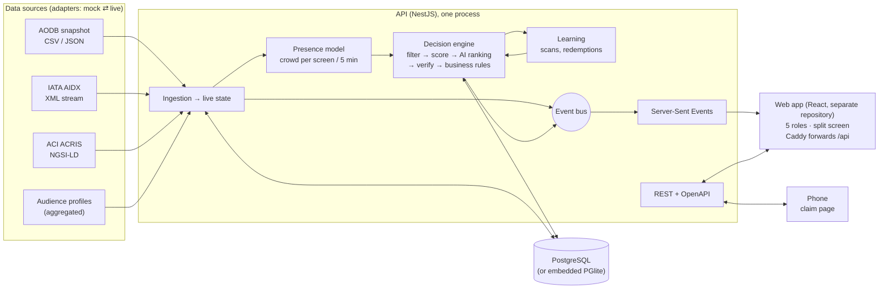

# Airport Retail Media Platform: backend

Ads and promotions on airport screens, chosen for **the passengers actually in front of each screen**. Flight
movements (AODB snapshot + IATA AIDX updates) and passenger flow (ACI ACRIS) become an aggregated crowd
profile per screen and per 5-minute window; every 15-second slot goes to the campaign that fits that crowd
best. An AI ranking is used only after six deterministic checks pass, and every decision keeps its evidence
trail. A delayed flight, a gate change or a promo claimed on a phone shows up across all roles in under a
second.

Everything runs against a fictional airport, **Meridian International (MQI)**, with invented airlines, brands,
outlets and places. No personal data: every audience figure is an aggregate.

The platform is two repositories (`backend/` and `frontend/`, side by side in `Airport-Retail-Media/`) with no code in common; they meet only over HTTP:

| Repository             | What it is                                                                                    |
| ---------------------- | --------------------------------------------------------------------------------------------- |
| **backend** (this one) | Adapters, simulation, presence model, decision engine, analytics; REST + SSE API (NestJS)     |
| **frontend**           | The web app (React): five roles, simulation bar, split screen, phone claim page; Caddy server |

The web app's server forwards `/api` to this API, so the browser sees one origin (no CORS) and QR claim links
work wherever the page is opened.

**Playground:** _URL to be added after deployment_ · **API docs:** `/api/docs` on any running instance

## Try it in five minutes

With both repositories running (below), open the web app:

1. Press **Demo** (top bar). The guide loads the worked example: Gate 42 at 14:10, with
   Halcyon Airways on the left and the Gate 42 screen on the right (split screen).
2. **Why this ad?** 420 passengers wait at gates 42–43 (58% holiday, 57% international, XH501 already 45
   minutes late). The perfume offer scores 0.86 and plays; toys (0.52) come next; the lounge (0.21) is held back.
3. **Inject the delay.** XH501 slips another 30 minutes through the AIDX adapter. The Gate 42 screen re-plans in
   well under a second to Halcyon's goodwill meal voucher, co-funded by Brewline Coffee. The guide shows the
   measured time.
4. **Scan the QR code with a phone.** The claim page shows the offer, a countdown to XH501's gate closing, the
   outlet, and a personal code with one extra code to share with family. The sale appears on Brewline's
   retailer dashboard.
5. **Operations.** Take the screen offline (the admin map turns red; an incident opens after 5 simulated
   minutes), see why one campaign beat another, pin an override with a reason.

The web app repository has the full 15-minute demo script (`docs/demo-script.md`).

## Run it

**Docker** (the API and PostgreSQL 17):

```bash
docker compose up --build        # → API on http://localhost:3000, Swagger UI at /api/docs
```

Then, in the web app repository, `docker compose up --build` → http://localhost:8080. The web container joins
this stack's `arm-edge` network and forwards `/api` to it. The first start generates the mock airport day
(about 20 s); data persists in Docker volumes. Claim links follow the address the page is opened on
(`PUBLIC_BASE_URL` overrides it).

**Single container, embedded database:** `docker build -t arm-api . && docker run -p 3000:8080 arm-api`

**Development** (Node.js 22+, pnpm 11 via `corepack enable`):

```bash
pnpm install
pnpm --filter @arm/api dev        # API on :3000 (creates the database and mock data on first start)
pnpm test                         # 167 tests: domain, generator, API end-to-end
```

and `pnpm dev` in the web app repository (port 5173, proxies `/api` to port 3000, also on the LAN so a phone
can follow a screen's QR code).

## What each role can do

The web app repository describes every view. In short, there is no login: the header switches role, and retailer and airline views switch company (`?as=…` in the address,
so any view can be shared). One design system, a dark control-room theme for the admin and a light theme for
the business roles, English and Arabic (right to left), usable at 1440 and 1920 px.

| Role              | Dashboard and pages                                                                                                                                                                                                                                                                                                                                                                                                                                                                                                                                                                                                                                                |
| ----------------- | ------------------------------------------------------------------------------------------------------------------------------------------------------------------------------------------------------------------------------------------------------------------------------------------------------------------------------------------------------------------------------------------------------------------------------------------------------------------------------------------------------------------------------------------------------------------------------------------------------------------------------------------------------------------ |
| **Admin**         | Control room: KPI strip (screens online, plays, impressions, revenue, campaigns, latency), live network map of T1/T2 with screen status and a presence heat overlay, incidents raised automatically (screen offline 5 min, feed lag, failed creative) with owner and status, feed health, engine performance · **Master data** (vendors, airlines, outlets, zones, gates, screens) · **Decision log** with the full evidence trail · **Rules & model** (score weights, relevance floor, exploration, frequency, competitor separation, airline priority; model version and learned performance)                                                                    |
| **Retailer**      | Live KPIs; passenger flow in the company's zones for the next 2 hours ("Next 60 min: about 5,100 passengers, 57% international, top destinations …"); recent sales (phone claims highlighted); sales by hour · **Campaigns**: pause/resume, stock toggle, run again, 30-day ROI, who redeems (share of redemptions vs share of passengers) with suggested weights in one click, A/B creatives, **best 3 slots tomorrow** with one-click booking, shareable report · **Campaign builder** with a live audience-match preview on the campaign's screens and a mock screen · **Creatives** with the **GenAI creative assistant** (English + Arabic) · **Promo codes** |
| **Media Manager** | Occupancy, media revenue, delivery per advertiser against pacing (under-delivery flagged), 7-day outlook · **Inventory & pricing**: screen × hour calendar (booked / available / premium) with suggested prices, package builder · **Approvals** with a brand-safety checklist · **Audience & conflicts**: segment heat map, why A beat B, manual pins with a reason · advertiser report links                                                                                                                                                                                                                                                                     |
| **Airline**       | Flights today on a timeline (boarding windows, delays), aggregated profile of its passengers, partner offers ranked by fit · **Gate screens**: what plays at its gates and why; its gate-area messages (priority in its boarding windows) · **Offers & goodwill**: delay-goodwill automation (co-funded voucher to the gate screens) with live activations and an editable threshold, co-marketing marketplace                                                                                                                                                                                                                                                     |
| **Passenger**     | Full-screen 16:9 / 9:16 player for any screen with the departures strip, promo QR with countdown and a **Why this ad?** panel (crowd, top candidates and scores, rules, AI checks) · mobile **claim page** for real phones                                                                                                                                                                                                                                                                                                                                                                                                                                         |

Every view has the **simulation bar**: airport time, play/pause, 1x/10x/60x, jump to a time, the worked example,
reset, and event injection (flight delay, gate change, screen offline/online). **Split screen** shows two roles
side by side under one clock.

## Architecture



More in [docs/architecture.md](docs/architecture.md): the decision pipeline, the evidence-first AI check, the
data model, live updates and the cause-and-effect path.

## Decision engine

Every screen gets a decision every slot (15 simulated seconds), and again at once when something changes:

1. **Profile:** the crowd in front of the screen for the current 5-minute window, from the flights at nearby
   gates (passengers × time to boarding × distance, own room only) and ACRIS queues.
2. **Filter:** status, approval, brand safety, schedule, placement, stock, budget, market, destination region,
   dwell time, crowd size, the airline's own boarding window, goodwill triggers.
3. **Score:** `0.8 × min(1, audience match × trigger boost) + 0.2 × learned performance`. Audience match is the
   mean, over the dimensions a campaign targets, of crowd share × segment weight.
4. **AI ranking, verified:** the AI agent (offline mock by default; any OpenAI-compatible model with
   `AI_PROVIDER=openai-compatible`) ranks the candidates and cites evidence ids. Its choice plays only if six
   deterministic checks pass: valid schema, hard rules respected, cited evidence exists, cited data trusted and
   fresh, stated facts match the recorded values, scores reproducible from the logged inputs. Otherwise the
   rule-based ranking plays.
5. **Business rules:** manual pins, relevance floor, airline priority, budget pacing, rotation, evenly spaced
   frequency caps, competitor separation, exploration.
6. **Log and learn:** each decision is stored with its evidence trail; plays, scans and redemptions update each
   campaign's per-segment conversion, and the model retrains every simulated hour.

The worked example is reproducible at any time (`POST /api/sim/scenario/worked-example`): Gate 42 at 14:10,
perfume 0.86 plays, toys 0.52 next, lounge 0.21 held back. At 60x every screen's playlist is built well within
the 250 ms a slot lasts (`pnpm --filter @arm/api perf`: p95 about 70–170 ms).

## Money and inventory definitions

Used the same way in every view, report and API response:

| Term                         | Definition                                                                                                                                                                                                                                                                                                             |
| ---------------------------- | ---------------------------------------------------------------------------------------------------------------------------------------------------------------------------------------------------------------------------------------------------------------------------------------------------------------------- |
| Viewers (impressions)        | Per play: passengers in front of the screen × the attention rate of the screen type                                                                                                                                                                                                                                    |
| Media spend                  | Per play: viewers ÷ 1,000 × the campaign's CPM, capped by its daily budget                                                                                                                                                                                                                                             |
| Media revenue (admin)        | The platform's ad revenue: the sum of all advertisers' media spend                                                                                                                                                                                                                                                     |
| Attributed sales             | Simulated sales linked to redemptions: each redeemed code counts the redeeming outlet's average basket                                                                                                                                                                                                                 |
| Return on spend              | attributed sales ÷ media spend (e.g. 3.2×)                                                                                                                                                                                                                                                                             |
| ROI                          | (attributed sales − media spend) ÷ media spend (e.g. +220%)                                                                                                                                                                                                                                                            |
| Booked / available / premium | Per screen and hour: booked when approved campaigns' budgets and frequency caps take 85% or more of its plays; premium when the predicted crowd is in the top 20%; otherwise available ("quiet" when nobody is expected)                                                                                               |
| Suggested price              | Per 15-second play: the screen's list price scaled by its predicted crowd against the network average                                                                                                                                                                                                                  |
| Promo claims                 | Every phone that scans a screen's QR code may claim its own code (plus one to share) until the linked flight's gate closes; claim requests are rate-limited per client address, and a campaign whose budget is spent stops showing QR codes; the phone remembers its code locally, nothing identifies it to the server |

## Data and adapters

| Setting           | Values                                | Source                                      |
| ----------------- | ------------------------------------- | ------------------------------------------- |
| `FLIGHT_SOURCE`   | `mock-aidx` (default), `vendor-api`   | AODB snapshot + IATA AIDX real-time updates |
| `SPACE_SOURCE`    | `mock-acris` (default), `ngsi-ld`     | ACI ACRIS facilities and queue measurements |
| `AUDIENCE_SOURCE` | `mock-rules` (default), `airline-api` | aggregated crowd profile per flight         |

The mock generator (`pnpm generate`) produces one operating day at the challenge's scale, each source in its
native format and parsed by the same parsers a live feed uses: ~900 flights (33-column AODB), ~3,200 AIDX
updates, ACRIS zones/checkpoints/queues, 180 screens, 40 outlets, 29 advertisers (11 airlines), 25 campaigns,
26 creatives (English + Arabic) and 30 days of history. Profiles follow plausibility rules (a Monday 07:00
domestic flight skews to business travellers aged 25–44; a Friday-evening holiday route to families and
couples). See [docs/adapter-guide.md](docs/adapter-guide.md) for formats, field mappings and how to add a live
source.

## API

OpenAPI 3.1 generated from the same zod schemas that validate every request: Swagger UI at `/api/docs`, the
document at `/api/openapi.json` and in [docs/openapi.json](docs/openapi.json) (a test fails if it is out of
date). Live updates stream from `/api/stream` (Server-Sent Events).

## Configuration

Every setting has a working default for the offline demo; see [.env.example](.env.example). Copy it to `.env`
(next to it): the API reads that file on start, and Docker Compose reads it for the values it passes on. The ones you are
most likely to change:

| Variable                                           | Default                           | Purpose                                                                            |
| -------------------------------------------------- | --------------------------------- | ---------------------------------------------------------------------------------- |
| `DATABASE_URL`                                     | `pglite:./.pglite/arm`            | `postgres://…` or an embedded database (`pglite:<dir>`, `pglite:memory`)           |
| `PUBLIC_BASE_URL`                                  | the address the page is opened on | Base URL in promo QR codes (set it on a public deployment)                         |
| `SIM_START_TIME`, `SIM_SPEED`, `SIM_AUTOPLAY`      | `13:50`, `1`, `true`              | Where and how the simulated day starts                                             |
| `AI_PROVIDER`                                      | `mock`                            | `mock`, `openai-compatible` (with `AI_API_URL`, `AI_API_KEY`, `AI_MODEL`) or `off` |
| `FLIGHT_SOURCE`, `SPACE_SOURCE`, `AUDIENCE_SOURCE` | mocks                             | Switch each source to its live adapter                                             |
| `TRUST_PROXY`                                      | (empty)                           | Express trust-proxy value behind a reverse proxy (`uniquelocal` in Docker)         |

## Stack and why

| Layer    | Choice                                                        | Why                                                                                                                             |
| -------- | ------------------------------------------------------------- | ------------------------------------------------------------------------------------------------------------------------------- |
| Language | TypeScript                                                    | One domain model (zod schemas) shared by generator, API and validation; the challenge's adapter example is TypeScript           |
| API      | NestJS 12 (Express), REST + SSE                               | Modules and dependency injection for adapters, engine and controllers; SSE is enough for one-way live pushes and passes proxies |
| Database | PostgreSQL 17 (Docker) or PGlite (embedded PostgreSQL)        | Same SQL and migrations everywhere; the embedded mode runs the tests and a single container with no database server             |
| ORM      | Drizzle + hand-written SQL migrations                         | Typed queries without a heavy runtime; migrations reviewable as SQL                                                             |
| AI       | Provider interface: offline mock, any OpenAI-compatible model | The demo works offline; a real model plugs in by configuration and is always verified                                           |
| Tests    | Vitest                                                        | Unit and end-to-end tests against the real app on an embedded database                                                          |

## Quality

- **Tests:** 167 automated tests, including end-to-end checks of the worked example, cause and effect within
  2 seconds, the AI verifier rejecting a forged citation, the claim flow, and the OpenAPI document.
- **Performance:** playlist build p95 about 70–170 ms at 60x for 180 screens (budget 250 ms); live updates in
  milliseconds.
- **Security scanning:** `bash scripts/scan.sh` runs the reviewers' commands unchanged on a clean export
  (`trivy fs --scanners vuln,secret,misconfig,license` and `opengrep --config=r/all`); neither reports anything
  above INFO. Dependencies are pinned; pnpm installs only versions public for at least 7 days, blocks
  non-registry sub-dependencies and refuses trust downgrades. The container runs as a non-root user on a
  read-only file system and publishes no port in production.
- **Privacy:** only aggregated crowd profiles; the claim flow asks for no personal data.

## CI/CD and deployment

One workflow, [.github/workflows/ci.yml](.github/workflows/ci.yml):

| Job        | When              | What                                                                                                             |
| ---------- | ----------------- | ---------------------------------------------------------------------------------------------------------------- |
| `verify`   | every push and PR | install (frozen lockfile), build, typecheck, lint, format check, all tests                                       |
| `security` | every push and PR | the reviewers' Trivy and OpenGrep commands (pinned, checksum-verified scanners); fails on any finding above INFO |
| `image`    | push to `main`    | builds the image and pushes `ghcr.io/<owner>/<repo>:<commit>` and `:latest`                                      |
| `deploy`   | after `image`     | runs that image, pinned by digest, on the VPS over SSH and waits until it is healthy                             |

The playground runs on a VPS with Docker: this stack (API and PostgreSQL, no public port) and the web app's
Caddy on ports 80 and 443 with automatic HTTPS, joined by the `arm-edge` network. Server setup, the GitHub
variables and secrets, rollback and operations: [docs/deployment.md](docs/deployment.md).

## Repository layout

| Path               | What it is                                                                                           |
| ------------------ | ---------------------------------------------------------------------------------------------------- |
| `packages/domain`  | Canonical domain model (zod), audience segments, the MQI floor plan, reference data                  |
| `packages/mockgen` | Deterministic generator of one airport day (AODB, AIDX, ACRIS, platform data)                        |
| `apps/api`         | NestJS API: database, adapters, simulation, presence, decision engine, analytics, creative assistant |
| `docs/`            | Architecture, adapter guide, deployment, OpenAPI document                                            |
| `samples/`         | The challenge's AODB and AIDX samples and the ACRIS schemas                                          |
| `deploy/`          | Production compose file (the published image and PostgreSQL)                                         |
| `scripts/`         | `scan.sh` (the reviewers' scanners), `install-scanners.sh`, `deploy.sh`                              |
| `.github/`         | The CI/CD workflow                                                                                   |
