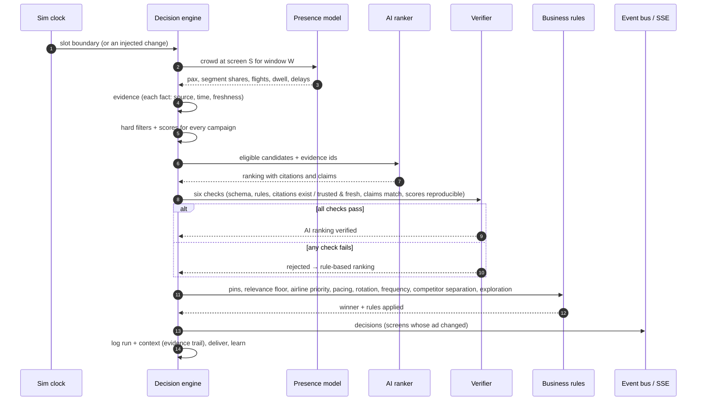
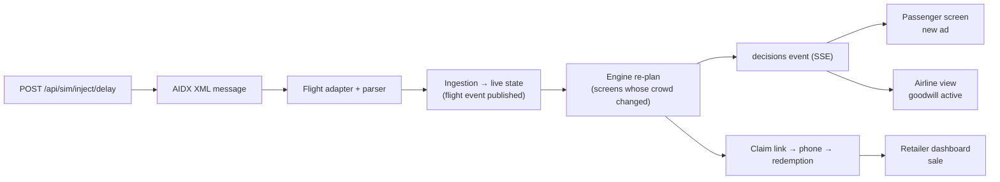

# Architecture

## Components

| Component          | Where                             | Responsibility                                                                                                                                                                                         |
| ------------------ | --------------------------------- | ------------------------------------------------------------------------------------------------------------------------------------------------------------------------------------------------------ |
| Domain model       | `packages/domain`                 | zod schemas and types for flights, flight events, terminals, zones, gates, queues, screens, advertisers, outlets, campaigns, creatives, promo codes, crowd profiles; the MQI floor plan                |
| Mock generator     | `packages/mockgen`                | One deterministic airport day in native formats (AODB CSV/JSON, AIDX XML, ACRIS NGSI-LD, audience profiles, platform data, 30 days of history)                                                         |
| Adapters           | `apps/api/src/adapters`           | `FlightSource`, `SpaceSource`, `AudienceSource` interfaces, each with a mock (replays the generated files through the real parsers) and a live implementation (HTTP polling with an origin allow-list) |
| Simulation         | `apps/api/src/sim`                | Shared clock (play, pause, 1x/10x/60x, jump, loop), ingestion into live state, event bus, screen fleet and heartbeats, incidents, event injection                                                      |
| Presence           | `apps/api/src/engine/presence.ts` | Crowd per zone and per screen for a 5-minute window, from flights (time to boarding, distance, own room) and ACRIS queues                                                                              |
| Decision engine    | `apps/api/src/engine`             | Per slot and on change: context (crowd + evidence), hard filters, scoring, AI ranking + verification, business rules, delivery, learning                                                               |
| Analytics          | `apps/api/src/analytics`          | Read models for the role views (dashboards, flow, inventory and pricing, best slots, delivery, heat maps) computed with the engine's own presence and scoring code                                     |
| Creative assistant | `apps/api/src/creative-assist`    | Brief → three bilingual creative variants (offline copywriter or an OpenAI-compatible model), schema-validated, with brand-safety checks                                                               |
| HTTP               | `apps/api/src/http`               | REST controllers (OpenAPI from the zod schemas) and the SSE stream                                                                                                                                     |
| Web app            | separate repository               | React: five roles, simulation bar, split screen, demo guide, passenger player, claim page, reports; English + Arabic; white label                                                                      |

## The decision pipeline

Contexts are rebuilt when their inputs change: a new presence window (spread over a few slots so no slot
rebuilds all 180 screens), a flight change affecting the screen, a master-data or rule change (at once).

## Cause and effect

An injected delay travels the same path as a real AIDX message, then re-plans the affected screens immediately,
even while the clock is paused:

Measured: about 70 ms from the API call to the decision event, under 300 ms to the screen in the browser
(covered by an end-to-end test with a 2-second limit).

## Data model (main tables)

| Area                 | Tables                                                                                                                                                                                                             |
| -------------------- | ------------------------------------------------------------------------------------------------------------------------------------------------------------------------------------------------------------------ |
| Reference and layout | terminals, zones, gates, checkpoints, queues, screens, outlets, airlines                                                                                                                                           |
| Flights              | flights (canonical), flight_events, queue_measurements, flight_profiles                                                                                                                                            |
| Commerce             | advertisers, campaigns, creatives, campaign_daily_stats (history), promo_codes, claim_links, redemptions                                                                                                           |
| Engine               | decision_contexts (crowd, evidence, candidates, AI checks), decisions (runs), impressions (per screen, campaign, creative and 5-minute window), campaign_segment_stats, model_versions, manual_pins, zone_presence |
| Operations           | incidents, settings                                                                                                                                                                                                |

Migrations are plain SQL in `apps/api/migrations` and run on start; the seed loads the generated day.

## Live updates

One Server-Sent Events stream (`/api/stream`, optional `topics=`) carries: clock, flight, flights_reloaded,
queue, screen, incident, feeds, sim, decisions, delivery, presence, model, catalog and claims. The web app opens
one connection per tab (shared by both panes of split screen), extrapolates the clock between messages and
refetches a view's data when its topics fire (debounced), so every role follows the same simulated world.

## Design decisions

- **Two repositories, one origin.** The frontend and backend share no code and deploy independently. The
  frontend's Caddy server (its Vite proxy in development) forwards `/api` to this API, so there is no CORS and
  claim links are built from the address the page was opened on.
- **Aggregates only.** Crowd profiles are shares of a flight's passengers; no individual is modelled or stored.
- **AI is advisory and checked.** The model ranks; deterministic code decides whether to trust the ranking.
- **Simulated time everywhere.** Every timestamp (decisions, impressions, claims, incidents) is simulation time;
  jumping back rewinds recorded data, and a restart rewinds anything a previous run recorded after its start.
- **Calibration.** Attention per screen type (gate 7.5%, totem 5%, video wall 10%, FIDS panel 6% of the crowd),
  QR scan and redemption rates and budgets are tuned so about 70–75% of slots are sold and campaigns pace through
  the day; the inventory view models demand the same way.
