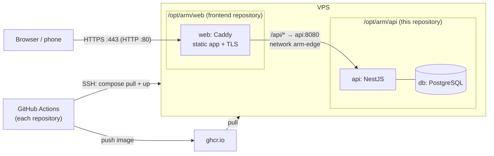

# Deployment (VPS)

The playground runs on one Linux server with Docker. Two stacks, one per repository, deployed by their own
pipelines:



Only the web container publishes ports. The API and the database are reachable only on Docker networks
(`arm-edge` between the two stacks, an internal network for the database).

## 1. The server (once)

Any 64-bit Linux server with 2 GB of RAM or more (Ubuntu 24.04 LTS, for example):

```bash
# Docker Engine and the compose plugin: https://docs.docker.com/engine/install/
sudo adduser --disabled-password --gecos "" deploy
sudo usermod -aG docker deploy
sudo mkdir -p /opt/arm && sudo chown deploy:deploy /opt/arm
# Firewall: SSH, HTTP and HTTPS only
sudo ufw allow OpenSSH && sudo ufw allow 80/tcp && sudo ufw allow 443/tcp && sudo ufw enable
```

A domain is optional but recommended: point an `A` record (for example `arm.example.com`) at the server, and
Caddy obtains and renews a Let's Encrypt certificate by itself. Without one, the playground runs on
`http://<server IP>`.

## 2. A deploy key (once)

On your computer:

```bash
ssh-keygen -t ed25519 -N "" -C "arm-deploy" -f arm-deploy
ssh-copy-id -i arm-deploy.pub deploy@<server>
ssh-keyscan -t ed25519 <server> > arm-known-hosts     # the server's host key, checked on every deploy
```

## 3. GitHub settings (in both repositories)

Settings → Secrets and variables → Actions:

| Kind     | Name              | Value                                                         |
| -------- | ----------------- | ------------------------------------------------------------- |
| Variable | `VPS_HOST`        | the server's IP address or host name                          |
| Variable | `VPS_USER`        | `deploy`                                                      |
| Variable | `PLAYGROUND_URL`  | the public address, e.g. `https://arm.example.com` (optional) |
| Secret   | `VPS_SSH_KEY`     | the contents of `arm-deploy` (the private key)                |
| Secret   | `VPS_KNOWN_HOSTS` | the contents of `arm-known-hosts`                             |

The deploy job runs in the `production` environment; add protection rules there (required reviewers, `main`
only) if you want a manual approval before each release. Until `VPS_HOST` and `VPS_USER` are set, pipelines
verify, scan and publish images but skip the deploy.

Images go to the GitHub Container Registry of the repository owner. They can stay private: each deploy logs the
server in with the job's short-lived token, pulls, and logs out again.

## 4. Server settings (once)

Each stack reads its own `.env` on the server (created empty, mode 600, by the first deploy; you can create
it beforehand):

```bash
# /opt/arm/api/.env
POSTGRES_PASSWORD=<a long random value, e.g. from: openssl rand -hex 24>
PUBLIC_BASE_URL=https://arm.example.com        # optional; otherwise claim links use the address the page is on
# AI_PROVIDER=openai-compatible                # optional: a real model for ranking and the creative assistant
# AI_API_URL=...  AI_API_KEY=...  AI_MODEL=...

# /opt/arm/web/.env
SITE_ADDRESS=arm.example.com                   # or leave unset for plain HTTP on the server's IP
```

`POSTGRES_PASSWORD` is required: the API stack does not start without it. It is used when the database is first
created; changing it later needs the password changed inside PostgreSQL as well.

## 5. Deploy

Push to `main` in this repository first (it creates the `arm-edge` network and starts the API), then in the
frontend repository. Each pipeline: verify → security → image → deploy. The deploy copies
`deploy/compose.yaml` to `/opt/arm/<api|web>`, writes the image digest to `.image`, pulls it and runs
`docker compose up --wait`, so the job fails if a container does not become healthy.

Check:

```bash
curl -s https://arm.example.com/api/health
```

Both pipelines can also be started by hand (Actions → ci-cd → Run workflow, on `main`).

## Rollback

- **From GitHub:** open an earlier successful run of the pipeline and re-run its `deploy` job; it deploys that
  run's image digest again.
- **On the server:**

  ```bash
  cd /opt/arm/api                                  # or /opt/arm/web
  cat .image                                       # the digest that is running
  echo "API_IMAGE=ghcr.io/<owner>/<repo>@sha256:<earlier digest>" > .image   # WEB_IMAGE=... for the web stack
  docker compose --env-file .env --env-file .image up -d --wait
  ```

## Operations

```bash
cd /opt/arm/api
docker compose --env-file .env --env-file .image ps
docker compose --env-file .env --env-file .image logs -f api
docker compose --env-file .env --env-file .image exec db pg_dump -U arm arm > arm-$(date +%F).sql   # backup
```

The simulation clock lives in the API process: restarting the API starts the simulated day again from
`SIM_START_TIME`, and anything recorded after that time is rewound. A playground that runs for days loops the
operating day (`SIM_LOOP_START_TIME`).

If the server already runs a web server on ports 80 and 443, set `HTTP_PORT` and `HTTPS_PORT` in
`/opt/arm/web/.env` (for example 8080 and 8443), leave `SITE_ADDRESS` unset (the existing server then handles
HTTPS) and forward the playground's host name to `http://127.0.0.1:8080`; also set `BIND_ADDRESS=127.0.0.1`
so the port is not public.
